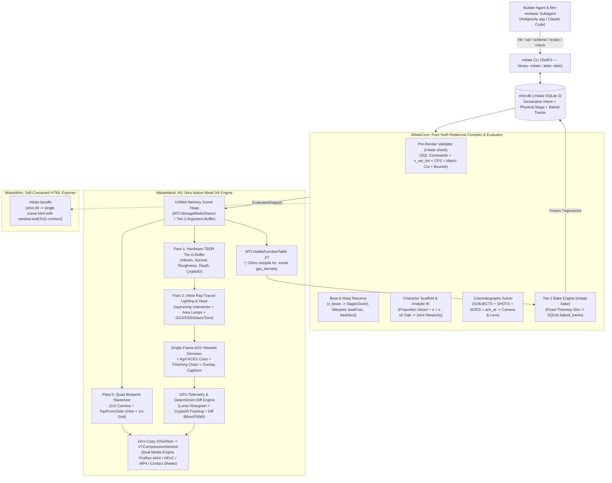

last updated: 2026-11-08

# mitate v2: Architecture, SQLite Soundstage Design & Roadmap

A deterministic, agent-first 3D cinematography, physics, and animation engine
built for **Claude Code** and **Google Antigravity (`agy`)** on Apple Silicon
(Mac Studio M2 Ultra).

`mitate` v2 synthesizes everything `mitate` v1 proved — **`t` as a random-access
coordinate**, **relative beat addressing**, **the `SIZES`/`SHOTS` cinematography
solver**, **parametric character scaffolds**, **Tier-1 bake-time simulation**,
and **the three-axis review instruments (`sheet`, `strip`, `probe`, `smoke`)** —
with the **Slate** architecture: a **single-file SQLite 3 Virtual Soundstage
(`shot.db`)** and a **zero-copy Apple Silicon Native Swift 6 + Metal 3/4
rendering engine (`MitateMetal`)**, plus a self-contained HTML exporter
(`mitate bundle`) that preserves the `window.seekTo(t)` web contract.

Read [`../VISION.md`](../VISION.md) first for why determinism comes first and why
declarations live in SQLite. The v1 founding record and measurements remain in
[`predecessor-record.md`](predecessor-record.md),
[`addressing.md`](addressing.md), [`representation.md`](representation.md), and
[`physics-bake-proposal.md`](physics-bake-proposal.md).

---

## 1. Why mitate v2: What Changed and What Carries Over

### 1.1 What v1 Proved vs. Where v1 Fought the Agent

In `mitate` v1, every scene was a ~1,500-line self-contained HTML file carrying
an embedded ~1.1 MB `three.js` bundle and <!--derived:fences-->7<!--/derived-->
replicated JavaScript fence blocks (`CONTRACT`, `KERNEL`, `SOLVER`, `RIG`,
`DRIVER`, `CHARACTER`, `HTML`). Watching real agent builds in `agy` and Claude
Code (`docs/harness-loop.md`) exposed three structural bottlenecks:

| Bottleneck in v1 (Monolithic HTML + Headless Browser) | How `mitate` v2 (`shot.db` + Native Swift/Metal) Solves It |
| :--- | :--- |
| **Editing Friction & Fence Tax:** Changing a lamp, retiming a beat, or tweaking a shader meant rewriting a 1,500-line HTML file and maintaining byte-parity across every carrier's fenced blocks. | **Surgical 1-Line SQL:** `mitate sql shot.db "UPDATE lamps SET lumens=2800, kelvin=3400 WHERE actor_id='key'"` mutates only the target row. Zero fence replication across scenes. |
| **Per-Scene Setup Overhead:** Every scratch workspace needed `package.json`, `bun add three playwright-core`, Chromium binary resolution, and platform WebGPU flag workarounds (`--use-angle=metal` vs SwiftShader black frames). | **Zero Per-Scene Setup:** One precompiled native binary (`mitate`, aliased as `slate`) initializes, validates, and renders any `shot.db` anywhere on disk in milliseconds. |
| **Slow & Blind Feedback Loop:** Cold-build transcripts proved agents read reference docs only in the first 1–6 minutes and never open them mid-build. When an extent was wrong or a contact missed in depth, nothing told the agent at edit time. | **Instant SQLite Constraints + ~40ms `quad` + Situated JSON Telemetry:** SQL `CHECK`/`FOREIGN KEY` constraints reject bad edits immediately; `mitate quad` renders a 2×2 Camera + Top/Front/Side ortho blueprint in ~40ms; every command prints structured JSON (`meter`, `framing`, `contacts`, `lint`, and situated pointers). |
| **Hand-Declared Extent Drift (REP4):** Because `build.js check` only read static JS text, it could never compare `SUBJECTS.h/w/d` against runtime 3D geometry. | **Auto-Derived Bounds (`auto_bounds`):** `MitateCore` evaluates the exact 3D world-space bounding box of any actor or posed character rig at `t` directly when solving camera framing. |

### 1.2 Where v2 Agrees With and Diverges From the Raw "Slate" Spec

The initial Slate draft proposed a SQLite soundstage + M2 Ultra Metal 3 engine.
`mitate` v2 adopts its best architectural ideas while correcting seven places
where the draft conflicted with `mitate`'s Prime Directive or practical agent
workflows:

1. **Adopted from Slate:**
   - Single-file SQLite 3 scene state (`shot.db`) with `WAL` mode and `FOREIGN KEY` enforcement.
   - Cinematography-native vocabulary (`actors`, `props`, `lenses`, `lamps`, `atmospheres`, `swarms`, `finishing_chain`, `takes`) and LLM-natural units (Euler degrees, `aim_at`, Kelvin, `#RRGGBB` hex, millimeter lenses).
   - M2 Ultra Unified Memory (`MTLStorageModeShared`) + incremental `revision_seq` sync.
   - ~25ms dynamic Metal shader compilation via `MTLVisibleFunctionTable` function pointers (`gpu_kernels`).
   - Hardware TBDR Tile G-Buffer + Inline Ray-Traced lighting + zero-copy `IOSurface` → `VTCompressionSession` (`ProRes 4444` / `HEVC` / `H.264`).
   - `quad` 2×2 orthographic + camera scout view and automatic stdout exposure/framing JSON telemetry.
2. **Corrected for `mitate` v2:**
   - **Relative Beat Addressing replaces raw `time_sec`:** Raw timestamps break on the first beat retime (`addressing.md`). v2 adds `beats` (`v_beats`) and anchors `cue_sheet` and `shots` to `(beat_id, beat_frac)` (covariant) or `(beat_id, offset_sec, dur_sec)` (invariant physical duration).
   - **Random-Access `f(t)` Purity + Tier-1 `bake` replaces stateful `substeps_per_frame`:** Step-integrating `state_buffers` at runtime violates the Prime Directive. v2 enforces pure closed-form `KinematicsKernelFn(t)` by default and provides `mitate bake shot.db` to freeze simulated trajectories into `baked_tracks` so `seekTo(t)` stays $O(1)$ in any order.
   - **Single-Frame Deterministic Denoising replaces `MTLFXTemporalScaler`:** Temporal scalers and temporal GI caches carry history across frames, breaking random-access seek identity and smearing across hard cuts. v2 uses spatial-only scaling + single-frame AOV-guided wavelet denoising seeded purely by `(pixel_xy, sample_idx, seed)`.
   - **Cinematography Solver (`SIZES` + `SUBJECTS` + `SHOTS`) added above `lenses`:** `aim_at` solves orientation, not distance or framing. v2 embeds the `SIZES` ladder (`EWS`, `WS`, `FSA`, `FS`, `MS`, `MCU`, `CU`, `ECU`) and `shots` table so agents can frame by cinematographic intent while keeping raw camera coordinates available as an override.
   - **Parametric `characters` Rig + Explainer Primitives (`gear`, `ring`, `arrow3d`, `lathe`) added:** Agents cannot sculpt `.usdz` files from scratch in a prompt. v2 carries over `mitate`'s parametric biped/quadruped/creature scaffold (with 2-bone analytic IK and distance-driven gait) plus procedural explainer geometry in `props`.
   - **Zero External Dylib / Daemon Dependencies:** Drops the un-installed warm Blender Python daemon (`bridge_worker.py`) and external `libOpenImageDenoise` requirement in favor of a 100% self-contained Swift 6 + Metal binary using Apple's native frameworks.
   - **Full Three-Axis Review Instrument Suite (`sheet`, `strip`, `probe`, `smoke`, `bundle`):** Extends the CLI beyond `quad` and `shoot` so the `film-reviewer` subagent in `agy` and Claude Code can inspect Composition, Continuity, Semantics (`--nocap`), 3-axis Contact separation, and Seek Determinism Magnitude.

---

## 2. System Architecture



### 2.1 The Layer Split (Preserved from Founding Plan)

```text
kernel     pure functions of StageSnapshot(t): pose, materials, camera, shading
           — no wall-clock, no cross-frame history, state is a plain value at t
driver     produces StageClock(t):
           - timeline driver: StageClock(t) from beats + warp_segments (films)
           - bake driver:     fixed-step solver at build time -> baked_tracks
           - viewer driver:   StageClock(t) + interactive camera orbit
contract   Native: mitate CLI verbs (check, quad, sheet, strip, probe, smoke, shoot)
           Web:    window.seekTo(t) / DURATION / stopPlayback / sceneReady
```

---

## 3. Complete SQLite Soundstage + Declarative Schema (`schema.sql`)

Every scene is a standalone SQLite 3 database (`shot.db`) with `PRAGMA foreign_keys = ON;` and `PRAGMA journal_mode = WAL;`.

### 3.1 Declarative Intent Tables (Mitate Layer)

```sql
PRAGMA foreign_keys = ON;
PRAGMA journal_mode = WAL;

-- ============================================================================
-- A1. BEATS (Named Spans — Durations Accumulate, Never Hardcoded Timestamps)
-- ============================================================================
CREATE TABLE beats (
    id          TEXT PRIMARY KEY CHECK (length(id) > 0),
    seq_order   INTEGER NOT NULL UNIQUE,
    dur_sec     REAL NOT NULL CHECK (dur_sec > 0.0),
    caption     TEXT DEFAULT NULL,
    flash_at    REAL DEFAULT NULL CHECK (flash_at IS NULL OR (flash_at >= 0.0 AND flash_at <= 1.0)),
    flash_width REAL NOT NULL DEFAULT 0.25 CHECK (flash_width > 0.0),
    revision_seq INTEGER NOT NULL DEFAULT 1
);

CREATE VIEW v_beats AS
SELECT
    id,
    seq_order,
    dur_sec,
    COALESCE(SUM(dur_sec) OVER (ORDER BY seq_order ROWS BETWEEN UNBOUNDED PRECEDING AND 1 PRECEDING), 0.0) AS t0,
    SUM(dur_sec) OVER (ORDER BY seq_order ROWS BETWEEN UNBOUNDED PRECEDING AND CURRENT ROW) AS t1,
    caption,
    flash_at,
    flash_width
FROM beats
ORDER BY seq_order;

-- ============================================================================
-- A2. STYLE BIBLES (The Look as One Object — Switched via slate.active_bible)
-- ============================================================================
CREATE TABLE style_bibles (
    id              TEXT PRIMARY KEY CHECK (length(id) > 0),
    backdrop_mode   TEXT NOT NULL DEFAULT 'physical_sky'
                    CHECK (backdrop_mode IN ('physical_sky', 'solid_color', 'hdri_dome', 'alpha_transparent')),
    backdrop_color  TEXT NOT NULL DEFAULT '#141619',
    exposure_ev     REAL NOT NULL DEFAULT 0.0 CHECK (exposure_ev BETWEEN -20.0 AND 20.0),
    contrast        REAL NOT NULL DEFAULT 1.0 CHECK (contrast > 0.0),
    color_transform TEXT NOT NULL DEFAULT 'agx'
                    CHECK (color_transform IN ('agx', 'agx_punchy', 'aces_cg', 'filmic', 'linear_raw')),
    lens_mm         REAL NOT NULL DEFAULT 50.0 CHECK (lens_mm BETWEEN 1.0 AND 5000.0),
    camera_energy   TEXT NOT NULL DEFAULT 'locked'
                    CHECK (camera_energy IN ('locked', 'steadicam', 'handheld')),
    sway_amp        REAL NOT NULL DEFAULT 1.0 CHECK (sway_amp >= 0.0),
    cut_whip_sec    REAL NOT NULL DEFAULT 0.16 CHECK (cut_whip_sec >= 0.0),
    cut_blend_sec   REAL NOT NULL DEFAULT 0.80 CHECK (cut_blend_sec >= 0.0),
    bloom_strength  REAL NOT NULL DEFAULT 0.0 CHECK (bloom_strength >= 0.0),
    bloom_threshold REAL NOT NULL DEFAULT 0.9 CHECK (bloom_threshold >= 0.0),
    dof_fstop       REAL DEFAULT NULL CHECK (dof_fstop IS NULL OR dof_fstop BETWEEN 0.5 AND 128.0),
    palette_json    TEXT NOT NULL DEFAULT '{}' CHECK (json_valid(palette_json)),
    revision_seq    INTEGER NOT NULL DEFAULT 1
);

INSERT INTO style_bibles (id, backdrop_mode, backdrop_color, exposure_ev, color_transform, lens_mm, camera_energy)
VALUES
    ('workshop', 'solid_color', '#141619', 0.0, 'agx', 50.0, 'locked'),
    ('neon',     'solid_color', '#090a10', 0.4, 'agx_punchy', 35.0, 'steadicam'),
    ('daylight', 'physical_sky', '#87ceeb', 0.0, 'agx', 50.0, 'locked'),
    ('paper',    'solid_color', '#f4f1ea', 0.2, 'filmic', 50.0, 'locked');

-- ============================================================================
-- A3. SIZES (Kit-Owned Cinematographic Framing Ladder)
-- ============================================================================
CREATE TABLE sizes (
    rung        TEXT PRIMARY KEY,
    frame_frac  REAL NOT NULL CHECK (frame_frac > 0.0),
    anchor_y    REAL NOT NULL CHECK (anchor_y BETWEEN 0.0 AND 1.0),
    description TEXT NOT NULL
);

INSERT INTO sizes (rung, frame_frac, anchor_y, description) VALUES
    ('EWS', 0.20, 0.50, 'Extreme Wide Shot — speck in the world'),
    ('WS',  0.50, 0.50, 'Wide Shot — full body, generous air'),
    ('FSA', 0.70, 0.50, 'Full Shot Air — full body with breathing room (workhorse)'),
    ('FS',  0.95, 0.50, 'Full Shot — full body tight'),
    ('MS',  1.60, 0.68, 'Medium Shot — waist up'),
    ('MCU', 2.40, 0.78, 'Medium Close-Up — chest up'),
    ('CU',  3.60, 0.84, 'Close-Up — head / primary detail'),
    ('ECU', 6.00, 0.88, 'Extreme Close-Up — micro detail');

-- ============================================================================
-- A4. CHARACTERS (Parametric Skeleton + Shells + Analytic IK & Distance Gait)
-- ============================================================================
CREATE TABLE characters (
    actor_id        TEXT PRIMARY KEY REFERENCES actors(id) ON UPDATE CASCADE ON DELETE CASCADE,
    preset          TEXT NOT NULL DEFAULT 'biped'
                    CHECK (preset IN ('biped', 'quadruped', 'strider', 'custom')),
    quadruped       INTEGER NOT NULL DEFAULT 0 CHECK (quadruped IN (0, 1)),
    hip_h           REAL NOT NULL DEFAULT 1.05 CHECK (hip_h > 0.0),
    torso_len       REAL NOT NULL DEFAULT 0.68 CHECK (torso_len > 0.0),
    torso_tilt_deg  REAL NOT NULL DEFAULT 4.0,
    pelvis_r        REAL NOT NULL DEFAULT 0.22 CHECK (pelvis_r > 0.0),
    chest_r         REAL NOT NULL DEFAULT 0.26 CHECK (chest_r > 0.0),
    shoulder_w      REAL NOT NULL DEFAULT 0.58 CHECK (shoulder_w > 0.0),
    hip_w           REAL NOT NULL DEFAULT 0.36 CHECK (hip_w > 0.0),
    neck_len        REAL NOT NULL DEFAULT 0.20 CHECK (neck_len >= 0.0),
    neck_segs       INTEGER NOT NULL DEFAULT 2 CHECK (neck_segs BETWEEN 1 AND 12),
    head_r          REAL NOT NULL DEFAULT 0.22 CHECK (head_r > 0.0),
    muzzle_len      REAL NOT NULL DEFAULT 0.0 CHECK (muzzle_len >= 0.0),
    tail_len        REAL NOT NULL DEFAULT 0.0 CHECK (tail_len >= 0.0),
    tail_segs       INTEGER NOT NULL DEFAULT 4 CHECK (tail_segs BETWEEN 0 AND 16),
    fore_upper      REAL NOT NULL DEFAULT 0.42 CHECK (fore_upper > 0.0),
    fore_lower      REAL NOT NULL DEFAULT 0.40 CHECK (fore_lower > 0.0),
    fore_r          REAL NOT NULL DEFAULT 0.08 CHECK (fore_r > 0.0),
    hind_upper      REAL NOT NULL DEFAULT 0.54 CHECK (hind_upper > 0.0),
    hind_lower      REAL NOT NULL DEFAULT 0.52 CHECK (hind_lower > 0.0),
    hind_r          REAL NOT NULL DEFAULT 0.10 CHECK (hind_r > 0.0),
    foot_len        REAL NOT NULL DEFAULT 0.22 CHECK (foot_len >= 0.0),
    foot_h          REAL NOT NULL DEFAULT 0.08 CHECK (foot_h >= 0.0),
    fur_shells      INTEGER NOT NULL DEFAULT 0 CHECK (fur_shells BETWEEN 0 AND 16),
    fur_length_m    REAL NOT NULL DEFAULT 0.04 CHECK (fur_length_m >= 0.0),
    walk_start_x    REAL NOT NULL DEFAULT 0.0,
    stride_m        REAL NOT NULL DEFAULT 0.85 CHECK (stride_m > 0.0),
    step_lift_m     REAL NOT NULL DEFAULT 0.14 CHECK (step_lift_m >= 0.0),
    shader_map_json TEXT NOT NULL DEFAULT '{"default":"studio_matte"}' CHECK (json_valid(shader_map_json)),
    revision_seq    INTEGER NOT NULL DEFAULT 1
);

-- ============================================================================
-- A5. SUBJECTS (Named Framing Targets — Auto-Derived Bounds by Default)
-- ============================================================================
CREATE TABLE subjects (
    id                 TEXT PRIMARY KEY CHECK (length(id) > 0),
    actor_id           TEXT REFERENCES actors(id) ON UPDATE CASCADE ON DELETE CASCADE,
    member_actors_json TEXT NOT NULL DEFAULT '[]' CHECK (json_valid(member_actors_json)),
    extent_mode        TEXT NOT NULL DEFAULT 'auto_bounds'
                       CHECK (extent_mode IN ('auto_bounds', 'declared_named')),
    height_m           REAL NOT NULL DEFAULT 2.0 CHECK (height_m > 0.0),
    width_m            REAL NOT NULL DEFAULT 2.0 CHECK (width_m > 0.0),
    depth_m            REAL NOT NULL DEFAULT 0.0 CHECK (depth_m >= 0.0),
    headroom_m         REAL NOT NULL DEFAULT 0.15 CHECK (headroom_m >= 0.0),
    extent_note        TEXT DEFAULT NULL,
    revision_seq       INTEGER NOT NULL DEFAULT 1
);

-- ============================================================================
-- A6. SHOTS (Declarative Shot List — Compiled to Camera + Lens per Frame)
-- ============================================================================
CREATE TABLE shots (
    id               INTEGER PRIMARY KEY AUTOINCREMENT,
    seq_order        INTEGER NOT NULL UNIQUE,
    beat_id          TEXT NOT NULL REFERENCES beats(id) ON UPDATE CASCADE ON DELETE CASCADE,
    beat_frac        REAL NOT NULL DEFAULT 0.0 CHECK (beat_frac >= 0.0 AND beat_frac <= 1.0),
    subject_id       TEXT NOT NULL REFERENCES subjects(id) ON UPDATE CASCADE ON DELETE CASCADE,
    size_rung        TEXT NOT NULL DEFAULT 'FSA' REFERENCES sizes(rung),
    angle_deg        REAL NOT NULL DEFAULT 30.0,
    elev_deg         REAL NOT NULL DEFAULT 8.0,
    fov_mm           REAL DEFAULT NULL CHECK (fov_mm IS NULL OR fov_mm BETWEEN 1.0 AND 5000.0),
    size2_rung       TEXT DEFAULT NULL REFERENCES sizes(rung),
    angle2_deg       REAL DEFAULT NULL,
    focus_subject_id TEXT DEFAULT NULL REFERENCES subjects(id) ON UPDATE CASCADE ON DELETE SET NULL,
    anchor_y         REAL DEFAULT NULL CHECK (anchor_y IS NULL OR (anchor_y >= 0.0 AND anchor_y <= 1.0)),
    anchor_x         REAL NOT NULL DEFAULT 0.0 CHECK (anchor_x BETWEEN -1.0 AND 1.0),
    cut_kind         TEXT NOT NULL DEFAULT 'hard' CHECK (cut_kind IN ('hard', 'whip', 'blend')),
    match_prev       INTEGER NOT NULL DEFAULT 0 CHECK (match_prev IN (0, 1)),
    revision_seq     INTEGER NOT NULL DEFAULT 1
);

-- ============================================================================
-- A7. WARP SEGMENTS & BAKED TRACKS (Presentation Time Warp & Tier-1 Sim Bakes)
-- ============================================================================
CREATE TABLE warp_segments (
    id        INTEGER PRIMARY KEY AUTOINCREMENT,
    beat_id   TEXT NOT NULL REFERENCES beats(id) ON UPDATE CASCADE ON DELETE CASCADE,
    beat_frac REAL NOT NULL DEFAULT 0.0 CHECK (beat_frac BETWEEN 0.0 AND 1.0),
    dur_sec   REAL NOT NULL CHECK (dur_sec > 0.0),
    rate      REAL NOT NULL CHECK (rate >= 0.0),
    revision_seq INTEGER NOT NULL DEFAULT 1
);

CREATE TABLE baked_tracks (
    id            TEXT PRIMARY KEY CHECK (length(id) > 0),
    target_domain TEXT NOT NULL CHECK (target_domain IN ('actors', 'state_buffers')),
    target_id     TEXT NOT NULL,
    sample_hz     REAL NOT NULL DEFAULT 60.0 CHECK (sample_hz > 0.0),
    frame_count   INTEGER NOT NULL CHECK (frame_count > 0),
    seed          INTEGER NOT NULL DEFAULT 101,
    inputs_sha256 TEXT NOT NULL,
    samples_blob  BLOB NOT NULL,
    revision_seq  INTEGER NOT NULL DEFAULT 1
);
```

### 3.2 Physical Soundstage Tables (Slate Layer)

All 14 tables from the Slate soundstage (`slate`, `media_bay`, `gpu_kernels`,
`state_buffers`, `surface_shaders`, `actors`, `props`, `lenses`, `lamps`,
`atmospheres`, `swarms`, `cue_sheet`, `finishing_chain`, `takes`) sit directly
beneath the declarative tables:

- **`slate`**: Singleton shot config (`id = 1`, `production_title`, `width`,
  `height`, `fps`, `title_card_text`, `subtitle_text`, `active_camera`,
  `active_bible REFERENCES style_bibles(id)`, sky/sun parameters,
  `ray_medium_kernel`, `color_transform`, `exposure_ev`, `contrast`,
  `random_seed`, `revision_seq`). Note: total duration is derived from
  `v_beats` when `beats` is non-empty, falling back to `slate.fallback_dur_sec`.
- **`actors`**: Right-handed Y-up stage graph (`id`, `parent_id`, `role IN
  ('rig','prop','camera','lamp','atmosphere','swarm')`, `x,y,z`, Euler degrees
  `pitch_deg,yaw_deg,roll_deg`, `scale_x,y,z`, `aim_at`, `bank_deg`, visibility
  and `crypto_id` flags).
- **`props`**: Parametric & asset geometry attached 1:1 to `actors(role='prop')`:
  - `shape IN ('sphere', 'cube', 'plane', 'cylinder', 'capsule', 'torus', 'cone', 'ring', 'gear', 'arrow3d', 'lathe', 'text3d', 'mesh_file')`
  - `shader_id REFERENCES surface_shaders(id)`
  - `radius_m`, `inner_radius_m`, `width_m`, `height_m`, `depth_m`, `tooth_count`, `bevel_radius_m`, `subdiv_level`, `text_string`, `extrude_m`, `params_json`.
- **`surface_shaders`**: Physically based + stylized material packs (`mode IN ('pbr','toon','sss','glass','unlit')`, `albedo`, `metalness`, `roughness`, `ior`, `clarity`, `abbe_dispersion`, `subsurface_weight`, `subsurface_mfp_rgb`, `clearcoat`, `fuzz_weight`, `fuzz_tint`, `glow_color`, `glow_nits`, `opacity`, `procedural_kernel`).
- **`cue_sheet`**: Relational animation timeline supporting both **beat-relative spans** (`beat_id`, `beat_frac`, `end_beat_id`, `end_beat_frac`, `offset_sec`, `dur_sec`) and explicit keyframe times (`time_sec`), with `curve IN ('ease_in_out', 'linear', 'ease_in', 'ease_out', 'hold_step', 'spring', 'bump')`.
- **`gpu_kernels`**: Hot-swappable Metal C++17 `[[visible]]` functions (`hook_slot IN ('kinematics', 'ray_medium', 'procedural_surface', 'lens_ray', 'finishing_pass')`, `purity_mode IN ('pure_t', 'baked_sim')`, `entry_symbol`, `msl_source`, `uniforms_json`).

---

## 4. M2 Ultra Native Metal Engine (`MitateMetal`)

### 4.1 Zero-Copy Unified Memory Heap (`MTLStorageModeShared`)
On Mac Studio M2 Ultra (76 GPU cores, 192 GB unified memory at 800 GB/s),
`MitateMetal` allocates all scene buffers in `MTLStorageModeShared`. At each
timestamp `t`, `MitateCore`'s `StageEvaluator` evaluates the pure `StageSnapshot(t)`
and writes actor transforms, camera matrices, shader rows, and lamp parameters
directly into shared memory pointers.

### 4.2 Three-Pass Deterministic Pipeline
1. **Pass 0 — `mitate quad` Blueprint Rasterizer (<15ms)**:
   Renders a 2×2 quad sheet:
   - Top-Left: Active Camera beauty preview (with framing guides & safe-title box).
   - Top-Right: Top-Down Orthographic (`XZ` plane) with 1m/5m grid, camera frustum cone, lamp direction vectors, and labeled actor bounding boxes.
   - Bottom-Left: Front Orthographic (`XY` plane).
   - Bottom-Right: Right-Side Orthographic (`ZY` plane).
2. **Pass 1 — Hardware TBDR G-Buffer (<1ms)**:
   Rasterizes primary camera visibility into Albedo, World Normal, Roughness/Metalness, Linear Depth, and `crypto_id` (32-bit deterministic actor/part ID).
3. **Pass 2 — Inline Ray-Traced Lighting, Materials & Atmosphere**:
   Uses Metal's `raytracing::intersector<triangle_data, instancing>` over the
   scene's `MTLInstanceAccelerationStructure` (TLAS) to compute:
   - Photometric area lamps (`panel`, `disk`, `bulb`, `spot`, `sun_directional`) with Kelvin blackbody tint and soft next-event shadow rays.
   - Material modes: physical `pbr` (GGX + clearcoat + fuzz), `toon` (TSL-equivalent unlit-base cel banding immune to ambient wash), `sss` (subsurface wrap + thickness scatter), and `glass` (dielectric refraction + Fresnel + Abbe dispersion).
   - Volumetric `atmospheres` (`haze_box`, `global_mist`) ray-marched with Henyey-Greenstein phase anisotropy and volumetric shadow rays.
4. **Pass 3 — Single-Frame AOV Wavelet Denoiser, AgX Color & Overlay Compositor**:
   - Edge-stopping A-Trous wavelet filter guided by Pass 1's noise-free Albedo, Normal, and Depth buffers (100% single-frame deterministic; zero temporal history).
   - Finishing chain (`halation`, `vignette`, `chromatic_fringe`, `film_grain`, `custom_kernel`) + `agx` / `agx_punchy` / `aces_cg` / `filmic` tone mapping.
   - CoreGraphics / CoreText overlay pass for beat captions, title cards, and world-cut flashes (strippable via `--nocap` for the Semantics review axis).

### 4.3 ~25ms Dynamic Kernel Linking (`MTLVisibleFunctionTable`)
Agent-authored `.metal` functions in `gpu_kernels` compile via
`MTLDevice.makeLibrary(source:options:)`, cached by SHA-256 hash, and bind into a
5-slot `MTLVisibleFunctionTable`:
- Slot 0: `kinematics` (`KinematicsKernelFn` — pure closed-form `f(t)` or input to `mitate bake`).
- Slot 1: `ray_medium` (`RayMediumKernelFn` — non-linear ray stepping / refraction).
- Slot 2: `procedural_surface` (`ProceduralSurfaceFn` — custom procedural BXDF/SDF patterns).
- Slot 3: `lens_ray` (`LensRayKernelFn` — custom camera optics).
- Slot 4: `finishing_pass` (`FinishingKernelFn` — custom post-processing).

---

## 5. Agent-Driven CLI & Review Instruments (`mitate` / `slate`)

Designed specifically for **Antigravity (`agy`)** and **Claude Code** so that
every command is fast, self-documenting, and emits situated JSON telemetry:

```bash
# 1. Discover schema or apply a tested SQL recipe
mitate schema [table_name]
mitate recipe [three-point-lights|character-walk|rack-focus|explainer-gears]

# 2. Initialize a soundstage database from a preset
mitate init shot.db [--preset three-point-studio|sunlit-exterior|explainer-stage|character-stage]

# 3. Mutate the stage with atomic SQL
mitate sql shot.db "
  INSERT INTO beats (id, seq_order, dur_sec, caption) VALUES ('intro', 1, 2.8, '1 · The drive gear engages');
  UPDATE props SET shape='gear', radius_m=1.2, tooth_count=16 WHERE actor_id='hero_prop';
"

# 4. Attach a custom Metal GPU kernel (~25ms JIT compile)
mitate kernel shot.db --id vortex_motion --slot kinematics --file vortex.metal

# 5. Optional: Run Tier-1 deterministic bake into baked_tracks
mitate bake shot.db [--seed 101]

# 6. Pre-render validation (<5ms, no GPU)
mitate check shot.db

# 7. Axis 1 (Composition) & Spatial Scout: 2x2 Camera + Top/Front/Side Ortho (~40ms)
mitate quad shot.db [--t 1.4] --out scout_quad.png

# 8. Axis 1 & 3 (Composition & Semantics): Beat Contact Sheet + .squint.jpg + --nocap
mitate sheet shot.db [--frac 0.6] [--nocap] --out sheet.jpg

# 9. Axis 2 (Continuity): Consecutive frames tiled across a beat window
mitate strip shot.db --from intro@0.2 --to intro@0.8 --out strip.jpg

# 10. 3-Axis Contact & Extent Probe: Exact world AABB separation & screen projection
mitate probe shot.db --t intro@0.5 --sep gear_a gear_b

# 11. Determinism & Quality Gate: Out-of-order seek byte-identity + Diff Magnitude BBox
mitate smoke shot.db [--dump-frames]

# 12. Shoot Stills or Zero-Copy Hardware Video (MP4 / ProRes 4444)
mitate shoot shot.db --mode dailies|hero|reference --out take01.mp4

# 13. Export Self-Contained Web Player (window.seekTo(t) contract)
mitate bundle shot.db --out scene.html
```

---

## 6. Roadmap & Implementation Milestones

### Phase v2.1 — Foundation & `MitateCore` (Relational Stage, Addressing, Solver, Check)
- **Deliverables**:
  - `Package.swift` (Swift 6, macOS Apple Silicon native).
  - `MitateCore`: `Schema.swift`, `StageDB.swift`, `BeatAddressing.swift`, `CharacterRig.swift`, `CameraSolver.swift`, `StageEvaluator.swift`, `BakeEngine.swift`, `StageCheck.swift`.
  - CLI commands: `init`, `sql`, `schema`, `recipe`, `check`, `bake`, `probe`.
- **Gate**:
  - All SQLite `CHECK` and `FOREIGN KEY` constraints verified.
  - `mitate check` catches broken beat/shot references, `match_prev` violations, caption CPS > 30, and unbaked `baked_sim` kernels, with red-before-green bracket tests in `SchemaAndCheckBrackets.swift`.
  - `StageEvaluator.evaluate(at: t)` is proven $O(1)$ and identical regardless of call order.

### Phase v2.2 — `MitateMetal` Core, Procedural Meshes & `quad` / `shoot`
- **Deliverables**:
  - `MetalStage.swift`, `MeshBuilder.swift` (`sphere`, `cube`, `cylinder`, `capsule`, `torus`, `cone`, `ring`, `gear`, `arrow3d`, `lathe`, `text3d`, plus articulated `characters` hulls and fur shells).
  - `KernelJIT.swift` (`MTLVisibleFunctionTable` ~25ms runtime `.metal` compiler).
  - `HybridRenderer.swift` + `stage_shaders.metal` (Pass 0 `quad` 2×2 blueprint, Pass 1 TBDR G-Buffer + `crypto_id`, Pass 2 Inline Ray-Traced area lamps + shadows + reflections + PBR/Toon/SSS/Glass + volumetric haze).
  - `FinishingAndMeter.swift` (single-frame AOV wavelet denoiser, AgX tone mapping, GPU luma histogram meter, `crypto_id` framing report).
  - `MediaRecorder.swift` (`IOSurface` → `VTCompressionSession` MP4/ProRes 4444 + PNG/JPG output).
- **Gate**:
  - `mitate quad` and `mitate shoot` render on M2 Ultra in <100ms per still frame with structured JSON exposure and framing telemetry.
  - `KernelJITTests` verifies <50ms hot-reload of a custom `.metal` kernel into `MTLVisibleFunctionTable`.

### Phase v2.3 — Review Instruments (`sheet`, `strip`, `smoke` with Diff Magnitude) & `MitateWeb` (`bundle`)
- **Deliverables**:
  - `mitate sheet` (1 frame per beat + `.squint.jpg` 90px silhouette strip + `--nocap` text stripping).
  - `mitate strip` (consecutive frames tiled across any `beat@frac` window).
  - `mitate smoke` (out-of-order seek determinism across sample plan + transition midpoints, reporting `changed_pixels`, `bbox`, `max_channel_delta`, and `psnr_db`).
  - `MitateWeb/HTMLBundler.swift` (`mitate bundle shot.db --out scene.html` emitting a single self-contained HTML file honoring the `window.seekTo(t)` contract).
- **Gate**:
  - `MetalDeterminismTests` proves 0-byte difference across out-of-order seeks on M2 Ultra Metal, and verifies the diff-magnitude locator on an injected 1-pixel mutation.
  - Bundled HTML passes the window contract (`seekTo`, `DURATION`, `stopPlayback`, `sceneReady`).

### Phase v2.4 — Agent Plugin Integration (`agy` + Claude Code) & Calibration Portfolio
- **Deliverables**:
  - Updated `plugin/skills/mitate/SKILL.md`, `plugin/agents/film-reviewer.md`, `plugin/rules/AGENTS.md`, and `plugin/skills/mitate/references/` for the v2 workflow.
  - Two v2 calibration scenes built and verified through the full instrument stack:
    1. `scenes/gearbox-v2.db` (technical explainer: interlocking procedural gears, callouts, style-bible switch `workshop` ↔ `neon`).
    2. `scenes/bear-and-bees-v2.db` (character comedy short: quadruped character rig, fur shells, Tier-1 baked hive swing, rack focus).
- **Gate**:
  - Both calibration scenes pass `mitate check` and `mitate smoke` with zero warnings, and are reviewed by `film-reviewer` across Composition, Continuity, and Semantics.
