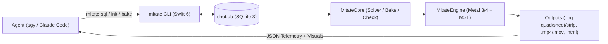

# mitate v2 LLM Knowledge Wiki (`wiki/index.md`)

> **Purpose:** Fast, modular, single-hop reference for LLM agents (`agy` and Claude Code) authoring, reviewing, or extending `mitate` v2 scenes and engine components.
> **Router:** [`../AGENTS.md`](../AGENTS.md) is the auto-loaded root entry point that routes here.

---

## 1. Wiki Topic Map

| Wiki Page | When to Open | What It Covers |
| :--- | :--- | :--- |
| **[`time-and-beats.md`](time-and-beats.md)** | Authoring motion, retiming a film, warping time, or baking physics | Prime Directive (`t` as a random-access coordinate), relative `beats`, `beatAt` / `ramp` / `pulse`, `warp_segments`, and Tier-1 `mitate bake` (`baked_tracks`). |
| **[`soundstage-schema.md`](soundstage-schema.md)** | Creating or mutating `shot.db` tables (`actors`, `props`, `lamps`, `surface_shaders`, etc.) | Complete SQLite 3 Soundstage table guide: `slate`, `actors`, `props`, `surface_shaders`, `lamps`, `atmospheres`, `cue_sheet`, `finishing_chain`, `takes`, and `media_bay`. |
| **[`cinematography-and-rigging.md`](cinematography-and-rigging.md)** | Framing shots, building characters, setting lenses, or configuring style bibles | `style_bibles`, `sizes`, `characters` (proportion vectors & distance-driven IK gait), `subjects` (`auto_bounds`), `lenses`, `shots`, and the deterministic camera solver. |
| **[`metal-engine-and-kernels.md`](metal-engine-and-kernels.md)** | Writing custom MSL `kinematics(t, state)` shaders, `swarms`, or modifying `MitateEngine` | Apple Silicon Swift 6 + Metal 3/4 pipeline, `kinematics(t, state)` ABI, `swarms` / `gpu_kernels` / `state_buffers`, single-frame `Denoise.metal`, and `MTLFXSpatialScaler`. |
| **[`instruments-and-review.md`](instruments-and-review.md)** | Running `mitate` CLI verbs, reading situated JSON telemetry, or running the 3-axis review loop | `init`, `schema`, `recipe`, `sql`, `check`, `bake`, `quad`, `sheet`, `strip`, `probe`, `smoke`, `shoot`, `bundle`, and the Composition / Continuity / Semantics review gates. |
| **[`patterns-and-recipes.md`](patterns-and-recipes.md)** | Looking for copy-pasteable SQL + MSL snippets, lighting rigs, or known visual traps | Verified recipes: low-key 4-lamp rig, cel/SSS/glass materials, procedural explainer primitives (`gear`, `ring`, `arrow3d`, `text3d`), scale-gating, and gait envelopes. |

---

## 2. Architecture at a Glance

---

## 3. Complete `shot.db` Table Directory

Every `shot.db` file contains two complementary table groups in one zero-config SQLite 3 database:

### Group A — Declarative Intent (`mitate` Layer)
1. **`beats`** (`id`, `seq`, `dur`, `caption`, `act`, `voice`) — Relative narrative timeline (`SUM(dur) == DURATION`).
2. **`style_bibles`** (`id`, `lighting_key`, `contrast_ratio`, `roughness_floor`, `color_harmony`, `camera_energy`, `dof_enabled`, `outline_width`, `palette_json`) — Global aesthetic & energy tokens.
3. **`sizes`** (`name`, `frac`, `min_pitch`, `max_pitch`, `fov_deg`) — Shot-size vocabulary (`ECU`, `CU`, `MCU`, `MS`, `MWS`, `FS`, `WS`, `EWS`).
4. **`characters`** (`actor_id`, `quadruped`, `proportions_json`, `material_map_json`) — Parametric skeletal & proportion rig.
5. **`subjects`** (`id`, `actor_id`, `pos_expr_or_json`, `h`, `w`, `d`, `aim_y_frac`, `auto_bounds`, `pad_name`, `pad_val`) — Framing targets with runtime world-AABB derivation (`auto_bounds = 1`).
6. **`shots`** (`id`, `seq`, `beat_start`, `beat_end`, `subject_id`, `size_name`, `angle_deg`, `height_offset`, `Move_type`, `energy_override`, `lens_id`, `lead_x`, `lead_y`, `cut_reason`) — Declarative camera cuts.
7. **`warp_segments`** (`id`, `seq`, `t_start`, `t_end`, `rate_start`, `rate_end`, `easing`) — Piecewise time-warping (holds, slow-motion, speed-ramps) with exact forward & inverse evaluation.
8. **`baked_tracks`** (`actor_id`, `sample_hz`, `seed`, `track_blob`) — Deterministic build-time physics/swarm trajectories written by `mitate bake`.

### Group B — Physical Soundstage (`Slate` Layer)
9. **`slate`** (`id`, `project_name`, `resolution_x`, `resolution_y`, `fps`, `total_frames`, `seed`, `spp_draft`, `spp_final`, `style_bible_id`) — Global project settings.
10. **`actors`** (`id`, `archetype`, `parent_id`, `tx`, `ty`, `tz`, `rx`, `ry`, `rz`, `sx`, `sy`, `sz`, `visible`) — Scene graph hierarchy.
11. **`props`** (`actor_id`, `csg_tree`, `shader_id`, `subdivision_level`) — Procedural CSG/SDF/primitive geometry (`box`, `sphere`, `cylinder`, `capsule`, `torus`, `cone`, `plane`, `lathe`, `extrude`, `gear`, `ring`, `arrow3d`, `text3d`).
12. **`surface_shaders`** (`id`, `model`, `base_color_r/g/b`, `metallic`, `roughness`, `subsurface`, `ior`, `transmission`, `emission`, `procedural_code`, `displacement_code`) — PBR, Toon/Cel, SSS, Glass, and procedural MSL shaders.
13. **`lenses`** (`actor_id`, `focal_length_mm`, `sensor_width_mm`, `f_stop`, `focus_distance`, `focus_actor_id`, `shutter_angle_deg`, `bokeh_blades`, `anamorphic_squeeze`) — Physical cinema optics.
14. **`lamps`** (`actor_id`, `type`, `kelvin`, `lumens`, `spread_angle`, `softness`, `volumetric_dust`) — Photometric lights (`area_rect`, `spot`, `sun`, `dome`, `point`).
15. **`atmospheres`** (`id`, `fog_density`, `anisotropy`, `base_height`, `falloff`, `scatter_r/g/b`) — Volumetric heterogeneous fog & participating media.
16. **`swarms`** (`actor_id`, `instance_count`, `prop_source_id`, `spawn_volume_csg`, `behavior_kernel_id`) — Hardware-instanced crowds & particle fields.
17. **`gpu_kernels`** (`id`, `entry_point`, `threadgroup_size_x`, `msl_source`) — Custom Metal compute shaders.
18. **`state_buffers`** (`id`, `element_stride_bytes`, `element_count`, `initial_data_blob`) — Typed data buffers bound to compute/vertex shaders.
19. **`cue_sheet`** (`id`, `actor_id`, `property_path`, `frame_start`, `frame_end`, `beat_start`, `beat_end`, `start_val`, `end_val`, `easing_curve`, `procedural_expr`) — Closed-form keyframe & expression tracks.
20. **`finishing_chain`** (`id`, `tone_mapper`, `exposure_ev`, `contrast`, `saturation`, `bloom_intensity`, `bloom_threshold`, `chromatic_aberration`, `film_grain_intensity`, `vignette_weight`) — Post-processing & color grading.
21. **`takes`** (`take_number`, `timestamp`, `render_time_ms`, `peak_vram_mb`, `mean_luminance`, `clipping_pct`, `agent_notes`) — Render audit log.
22. **`media_bay`** (`id`, `mime_type`, `encoding`, `width`, `height`, `data_blob`) — Embedded textures, LUTs, and baked heightfields.
